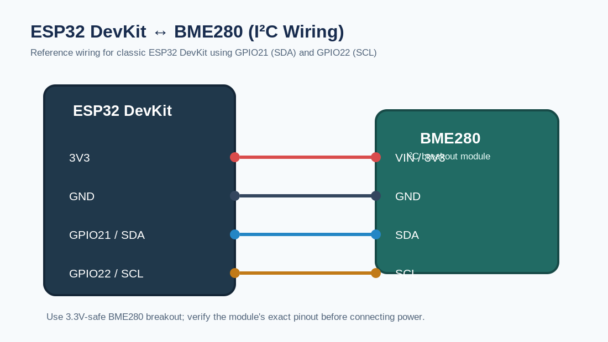
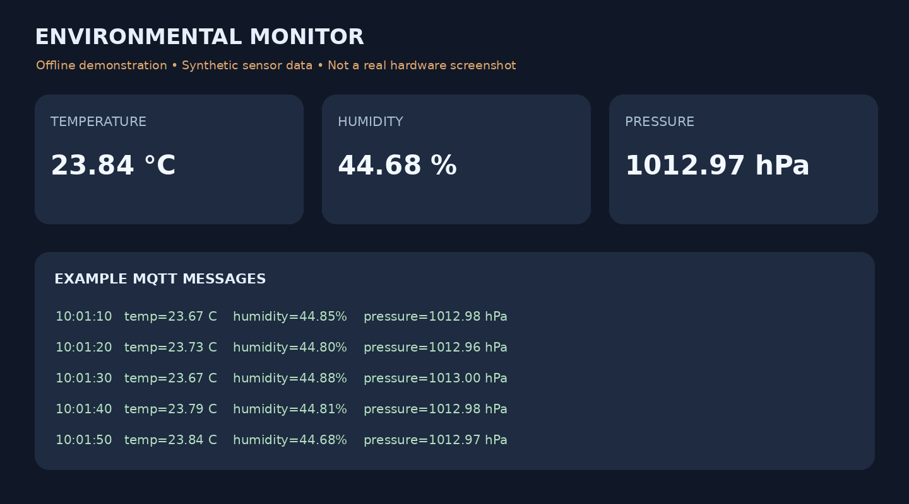

# Demo and diagram guide

## Wiring reference



| ESP32 DevKit | BME280 I2C module |
|---|---|
| 3V3 | VIN / 3V3 (verify breakout power input) |
| GND | GND |
| GPIO21 | SDA |
| GPIO22 | SCL |

The illustration assumes a classic ESP32 DevKit using default pins in `src/main.cpp`; do not assume it applies to other ESP32 variants. Use a breakout rated for 3.3V signals. Verify your particular module's pins and power requirements.

## Simulated dashboard preview



This is a mock visualization **not** a screenshot of operating physical hardware.

## Run the offline demonstration

```bash
python demo/simulate_messages.py
python -m unittest discover -s demo -p 'test_*.py'
```

The payload format matches the firmware's expected MQTT JSON shape (`device_id`, `temperature_c`, `humidity_pct`, `pressure_hpa`). The timestamp in each outer demo record is illustrative and is not transmitted by `src/main.cpp`.

## Firmware build (requires PlatformIO)

```bash
python -m pip install platformio
cp include/config.example.h include/config.h   # On Windows use: copy include\config.example.h include\config.h
pio run -e esp32dev
```

Or run the included GitHub Actions workflow. Never commit real Wi-Fi passwords in `include/config.h`.

## What still needs actual hardware

A successful build or passing mock-data tests cannot verify wiring, BME280 presence, Wi-Fi, broker delivery or real sensor accuracy. See [`verification-report.md`](verification-report.md).
